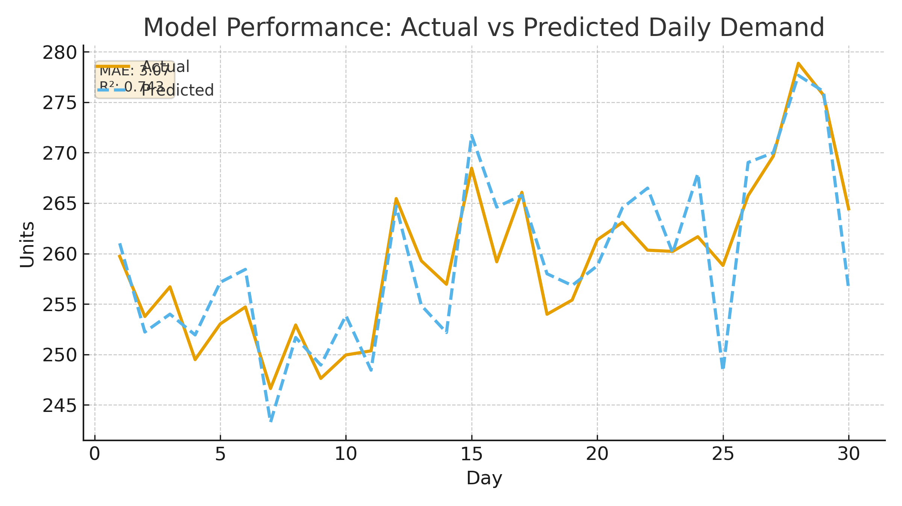
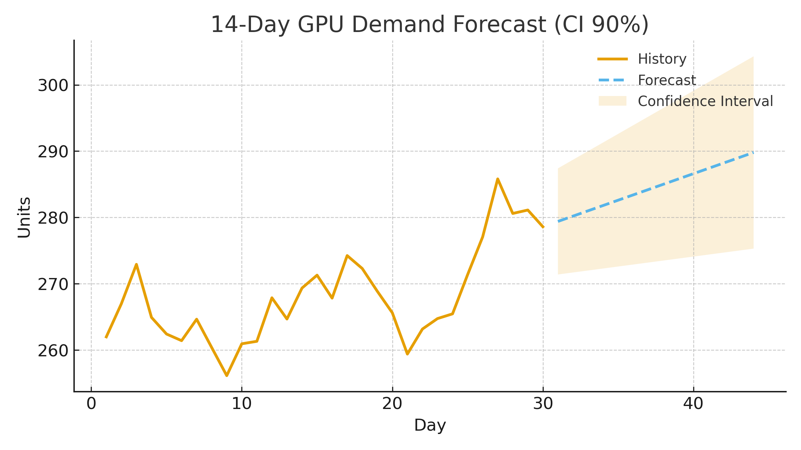
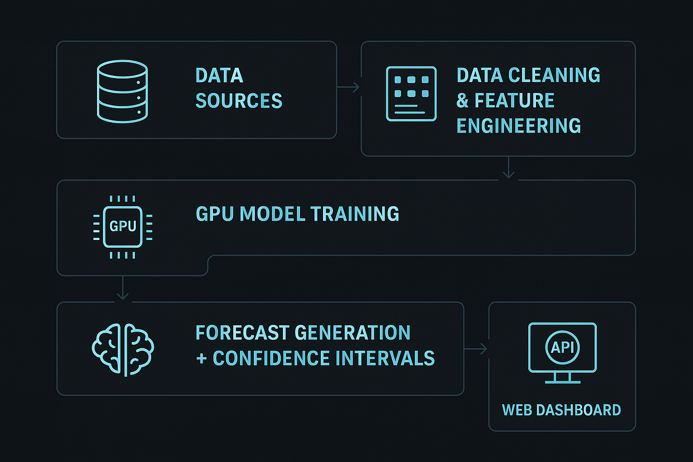

<!-- HEADER -->

<h1 align="center">Hey! I'm Damian</h1> 
<h3 align="center">Data Scientist • Python • Machine Learning • Forecasting</h3>

  
  
  

---

## 🧭 About me
I’m Damian, a **Data Scientist** with a background in Business Intelligence. Working with reports got me interested in what comes next: can we use the history we have to make a useful prediction?

That question keeps me busy with forecasting, Python and SQL. I’m also interested in financial services, particularly how models are validated, explained and used to support decisions.

🔎 **Before training:** what are we predicting, and what would we actually know at prediction time?  
🧪 **Before trusting a score:** does it beat a simple baseline on later, unseen data?  
🔧 **After evaluation:** where does it fail, and what does that tell us about the data?  

---

## ⚙️ Tech Stack

  

💡 **Analysis & modelling:** Python · Pandas · NumPy · scikit-learn · SQL  
🛠️ **Data & delivery:** BigQuery · Qlik Sense · Git · Cloud Functions · Cloud Scheduler  
🚀 **Exploring next:** XGBoost · Vertex AI · experiment tracking

---

## 🚀 Featured Projects

**FPL333 Analytics**  
Live dashboard · Scheduled ingestion · Modelling next

Fantasy football gives me a reason to build something I can use, and a prediction problem to work towards: how many points might a player score next gameweek?

**Working today:** a league dashboard in Next.js / TypeScript and scheduled Python ingestion into BigQuery using Cloud Functions and Cloud Scheduler. Data flows through RAW → STAGING → FEATURES; I still trigger feature builds manually.  
**Next up:** a simple baseline, testing on later gameweeks, then a player-points model and a closer look at its errors. Vertex AI comes later; neither the model nor the Vertex AI integration is deployed.  
🔗 [Repo](https://github.com/acroice/fpl333) · [Live](https://fpl333.vercel.app/)

*On the ideas list:* comparing CPU and GPU training for demand forecasting, and a small toolkit for retail data checks and KPIs. Both are concepts, with no published repositories yet.

---

<!-- 📊 Visuals -->
These visuals are here to introduce modelling questions. Their underlying data and calculations are not documented in this repo, so the displayed scores and intervals are illustrative, not verified results. The architecture sketch is conceptual, not the current FPL333 system.

### ⚙️ Model Evaluation

An overall score is a starting point. I also want to see when the predictions miss and whether those errors follow a pattern.

### 🔮 Forecasting

A forecast needs a clear horizon. An interval needs a check too: how often did it contain the outcome on unseen data?

### 🧱 System Design

The interesting part is what connects the boxes: when data arrives, which checks it passes, and whether the same features can be built again for a new prediction.

---
### 📚 Currently Learning
The questions I’m working through as I build:

- 🧮 **Features:** how to use lags and rolling windows without letting future information slip in.
- 🔧 **Validation:** how performance changes across time periods and player groups, not just on average.
- 🧰 **Reproducibility:** how to rerun an experiment and trace its data, settings and results.
- 📈 **Interpretation:** what feature importance and SHAP can tell me, and where their explanations stop.

---

## 💬 Let's Connect

  
  
  

---

## 📈 GitHub Stats

  

