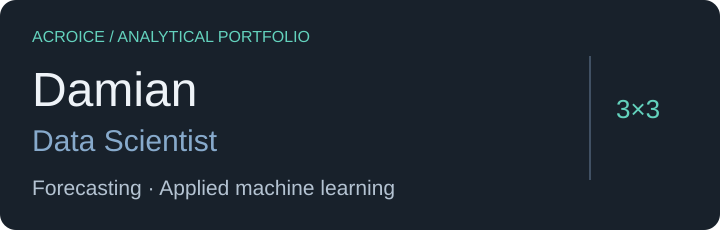
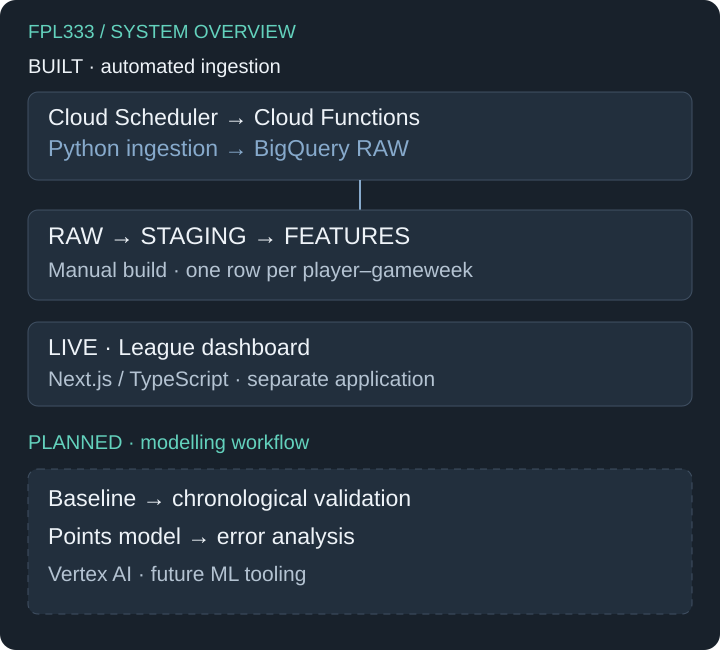
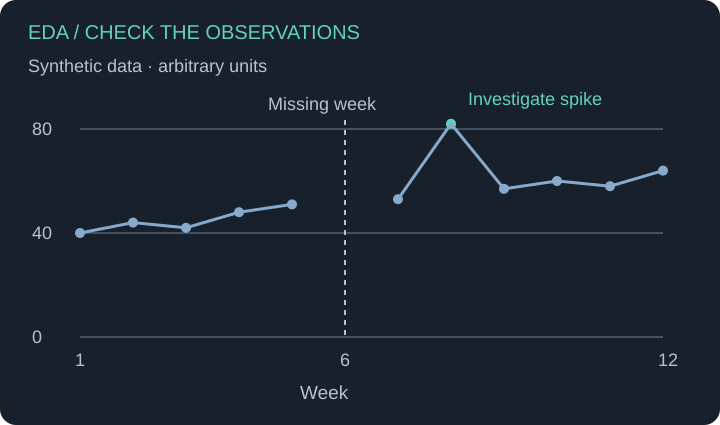
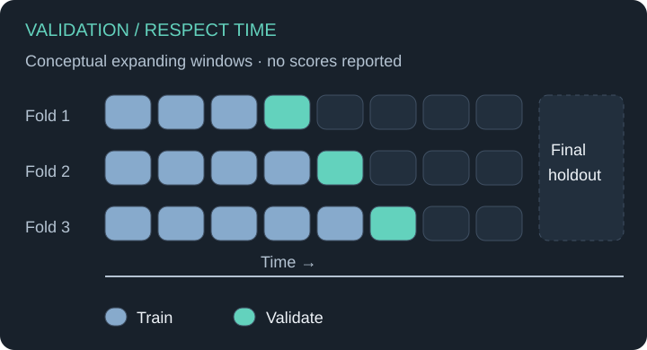
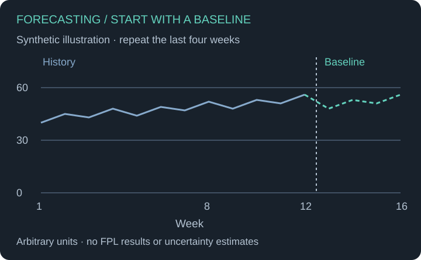

I'm Damian, a **Data Scientist with a background in Business Intelligence**. I focus on forecasting and applied machine learning: understanding the question, checking the data, and turning model outputs into useful predictions.

[FPL333 demo](https://fpl333.vercel.app) · [Project code](https://github.com/acroice/fpl333) · [LinkedIn](https://www.linkedin.com/in/damian-cichocki-3x3) · [Email](mailto:damiancichocki@icloud.com)

## FPL333 — from league data to player predictions

**How can historical player performance and fixture context support predictions for the next gameweek?** FPL333 is my ongoing project for exploring that question, alongside a working Fantasy Premier League dashboard.

### Built

- **League dashboard:** a live Next.js / TypeScript application for exploring league results.
- **Data ingestion:** Python → Google BigQuery, automated with Cloud Functions and Cloud Scheduler.
- **Data preparation:** RAW → STAGING → FEATURES, including a player–gameweek feature table. Feature builds are currently triggered manually.

One concrete modelling concern is **what was known before the gameweek deadline**. The pipeline uses prior-gameweek history for lagged features and pre-deadline snapshots for price and form; missing historical snapshots stay missing rather than being filled with today's values. [Read the pipeline documentation](https://github.com/acroice/fpl333/blob/main/pipeline/README.md).

### Next

Establish a baseline, validate chronologically, then develop a player-points model and analyse its errors. Vertex AI is a planned step for managing ML experiments and training. **The predictive model and Vertex AI integration are not deployed.**

[Explore the repository](https://github.com/acroice/fpl333) · [Open the dashboard](https://fpl333.vercel.app) · [Development roadmap](https://github.com/acroice/fpl333/blob/main/ROADMAP.md)

## Analytical approach

The visuals below illustrate the questions I want an analysis to answer. **They are methodological illustrations, not FPL333 results or evidence of a trained model.** The EDA and forecasting examples use synthetic data; the validation diagram explains the evaluation design.

### 01 / Explore the data before fitting a model

**Reading the example:** the gap is not a zero, and the spike needs investigation before it becomes a modelling assumption. Check completeness, unusual observations and the time at which each input becomes available.

### 02 / Evaluate in the order predictions will be made

**Evaluation design:** compare against a simple baseline on future gameweeks. Fit preprocessing within each training fold, inspect errors across relevant player groups, and reserve a final holdout for the selected approach. This is the planned evaluation workflow for FPL333.

### 03 / Make the prediction horizon explicit

**Reading the example:** repeating the last four observations gives a transparent seasonal-naive benchmark. The four-week period is illustrative, not an assumption about FPL. Define the horizon and assess accuracy on unseen periods; if intervals are introduced, check their empirical coverage before presenting uncertainty to a user.

[Visual sources and methodology](assets/profile/README.md) · Illustrations are reproducible with the included generator.

## Toolkit & development

**Analytical foundation:** Python, Pandas, NumPy and SQL for data preparation and exploration; scikit-learn for modelling workflows; Qlik Sense and BI experience for connecting analysis to business questions.

**Applied in FPL333:** BigQuery for analytical data, Cloud Functions and Cloud Scheduler for ingestion, and Next.js / TypeScript for the dashboard.

**Current development:** time-series feature engineering, baseline design, chronological validation and error analysis. Google Cloud, Vertex AI and MLOps support that Data Science direction.

---

**Let's connect:** [LinkedIn](https://www.linkedin.com/in/damian-cichocki-3x3) · [damiancichocki@icloud.com](mailto:damiancichocki@icloud.com)

Outside the analysis: football, and a soft spot for Pokémon.
