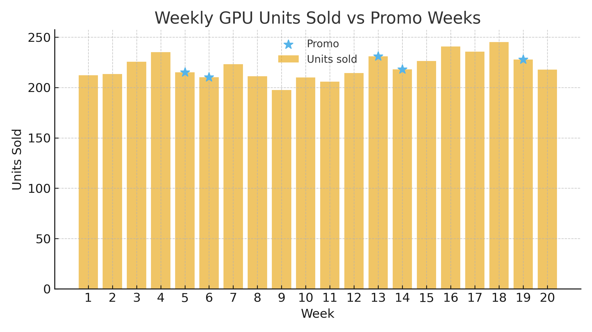

<!-- BANNER -->
<!-- 

  

 -->

<!-- HEADER -->

<h1 align="center">Hey! I'm Damian</h1> 
<h3 align="center">Data Scientist • Python • Machine Learning • Forecasting</h3>

  
  
  

---

## 🧭 About me
I’m a **Data Scientist** with a background in Business Intelligence, focused on forecasting and applied machine learning.
I’m interested in applying this foundation in financial services, where data quality, reproducible validation and interpretable results matter for decisions.
     
🔎 Approach: from business questions and data checks to features, validation and useful predictions  
⚙️ Working on: forecasting & analytics pipelines (Python · Pandas · SQL · scikit-learn · Qlik Sense)  
💡 Focus: data quality, feature engineering & reproducible analysis  
🚀 Currently deepening: chronological validation, error analysis & ML workflows on Google Cloud  
🧠 Philosophy: “Less noise, more signal — data science that drives decisions.”  

---

## ⚙️ Tech Stack

  

💡 **Core:** Python · Pandas · NumPy · scikit-learn · SQL · GCP / BigQuery · Qlik Sense · Git  
📚 **Currently Learning:** XGBoost · time-series forecasting · model documentation · GitHub Actions  
🚀 **Exploring Next:** Vertex AI · experiment tracking · ML pipeline automation

---

## 🚀 Featured Projects

**FPL333 Analytics** — a working Fantasy Premier League dashboard (Next.js / TypeScript).  
→ Scheduled Python → BigQuery ingestion (Cloud Functions + Cloud Scheduler); warehouse layers RAW → STAGING → FEATURES, with manual feature builds.  
→ Next: baseline, chronological validation, player-points modelling and error analysis; Vertex AI is planned, not deployed.  
🔗 [Repo](https://github.com/acroice/fpl333) · [Live](https://fpl333.vercel.app/)

*Exploring next:* demand-forecasting / CPU–GPU comparison, and a retail data-quality & KPI toolkit — concepts only, no published repos yet.

---

<!-- 📊 Visuals -->

I love exploring and visualizing data — from raw EDA to model explainability and forecasts.  
The visuals below illustrate these topics; their data sources and metrics are not documented here, so they should not be read as verified project results.
  
### 🧠 EDA & Insights

### ⚙️ Model Evaluation

### 🔮 Forecasting

### 🧱 System Design

---
### 📚 Currently Learning
Practical machine learning foundations through hands-on mini projects

- 🧮 **Feature Engineering for Time Series:** lags, rolling stats, calendar patterns  
- 🔧 **Model Validation:** chronological splits, baseline comparisons & error analysis  
- 🧰 **Automation:** CI/CD and version control for reproducible ML repos  
- 📈 **Interpretability:** SHAP, feature importance, partial dependence plots

---

## 💬 Let's Connect

  
  
  

---

## 📈 GitHub Stats

  

